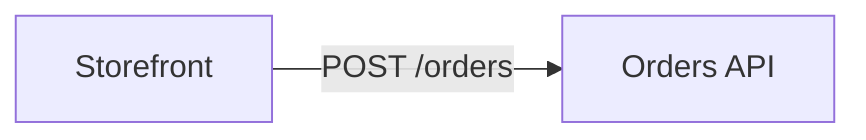

## Mermaid

| Diagram | In Schematlas |
| --- | --- |
| `flowchart`, `graph` | Read, edit, annotate, arrange |
| `sequenceDiagram` | Drawn with lifelines, frames and notes; participants annotate |
| `classDiagram`, `erDiagram`, `stateDiagram` | Read, annotate, arrange |
| Gantt, pie, mindmap and others | Listed only |

Notes are comment lines that Mermaid ignores:



In a sequence diagram, participants take the same `node` lines. Each Mermaid block in a Markdown file is its own diagram: `README.md#0`, `README.md#1`.

## draw.io

Pages of `.drawio` and `.dio` files are read one by one (`infra.drawio#1`). Notes are the shape's own properties, visible in draw.io under *Edit Data*: `schematlas-code`, `schematlas-note`, `schematlas-kind`. Positions stay in the file.

## DBML

A `.dbml` file opens in the schema canvas, like a connected database. Notes are comment lines, with tables named by schema:

```text
// @schematlas node public.orders code=src/orders/model.rs:12-60 note="One row per checkout"
```

Saving a live database as DBML merges into the existing file and keeps your notes, groups and comments.

## Excalidraw

A `.excalidraw` file opens in the Excalidraw editor inside Schematlas: draw freely, and each change is saved to the file. Choose *Sketch* under *New diagram* to start one. Shapes with their text become components and arrows attached to two shapes become connections, so a selected shape takes notes, code links and change flags like any other node. Notes are stored in the element's `customData`, which Excalidraw keeps:

```json
"customData": { "schematlas": { "code": [{ "path": "src/api.rs", "line": 12, "end_line": 80 }], "note": "Validates carts" } }
```

Agents read sketches and annotate them, but leave the drawing to you.

## Keys

| Key | Example |
| --- | --- |
| `code` | `code=src/api.rs:12-80` — repeat for several |
| `note` | `note="Validates carts"` |
| `kind` | `kind=service` |
| `tags` | `tags=http,core` |
| `color` | `color=#7fa98d` |
| `commit` | `commit=3f2c9e1`, set when a node is reviewed |

Code references are `path`, `path:12`, `path:12-80` or `path#L12-L80`, relative to the repository root. Unknown keys are kept.
