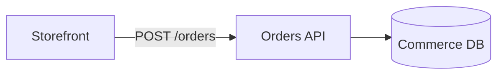

## Supported diagrams

| Family | In Schematlas |
| --- | --- |
| `flowchart`, `graph` | Read, edit, annotate and arrange |
| `classDiagram`, `erDiagram`, `stateDiagram` | Read, annotate and arrange |
| Sequence, Gantt, pie, mindmap and the others | Listed but not drawn |

Files ending in `.mmd` or `.mermaid` are diagrams, and so is every fenced `mermaid` code block in a Markdown file.

## Annotation lines

Schematlas adds one comment line per annotated element. Mermaid ignores lines starting with `%%`, so the diagram renders unchanged everywhere else.



The grammar:

```text
%% @schematlas diagram  key=value ...
%% @schematlas node <node id>  key=value ...
%% @schematlas edge <from id> <to id> [n]  key=value ...
```

- `n` picks among several edges between the same two nodes, counting from 0. It is omitted for the first.
- Values are single words, or double-quoted with `\"`, `\\` and `\n` escapes.
- Keys can repeat where a list makes sense: `code=a.rs:1 code=b.rs`.
- A malformed line, or one about a node that no longer exists, is ignored rather than breaking the diagram.

See [Annotations](/docs/annotations) for the keys.

## Where lines go

- An existing line for the same element is replaced in place.
- A new line goes after the last annotation line, or at the end of the file after a blank line.
- New nodes and edges are inserted above the annotation block, so annotations stay together at the end.
- Clearing every value of an annotation deletes its line.

## Labels

Labels can use `<br>` for line breaks, `<b>`/`<i>` or `**bold**`/`*italic*`, and HTML entities. They are drawn as text, never as HTML.

## Mermaid in Markdown

Each Mermaid block in a Markdown file is a diagram of its own, numbered from 0 in reading order: `README.md#0`, `README.md#1`. Its title is the nearest heading above it. Editing it rewrites only that block, re-indented to match its fence. Arrangements are saved as `.schematlas/layout/README.md.0.json`.
